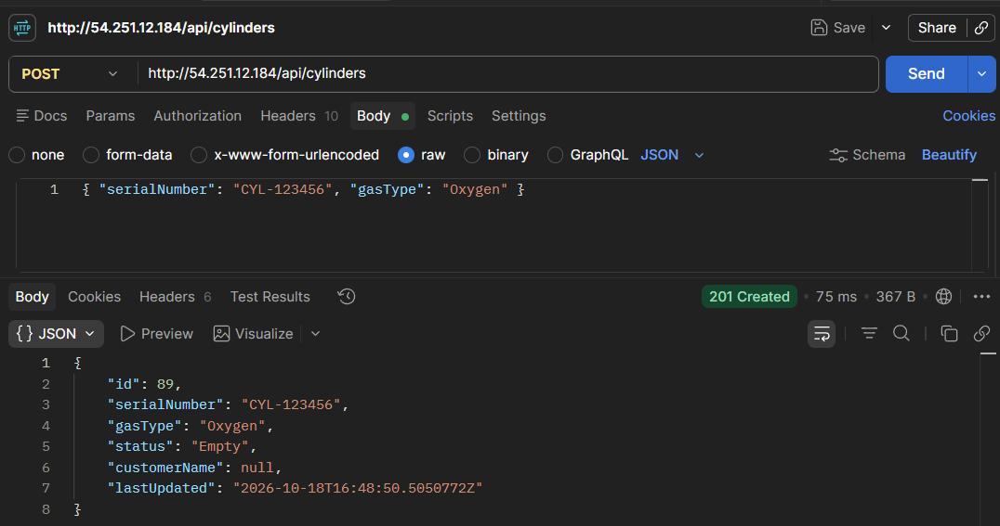
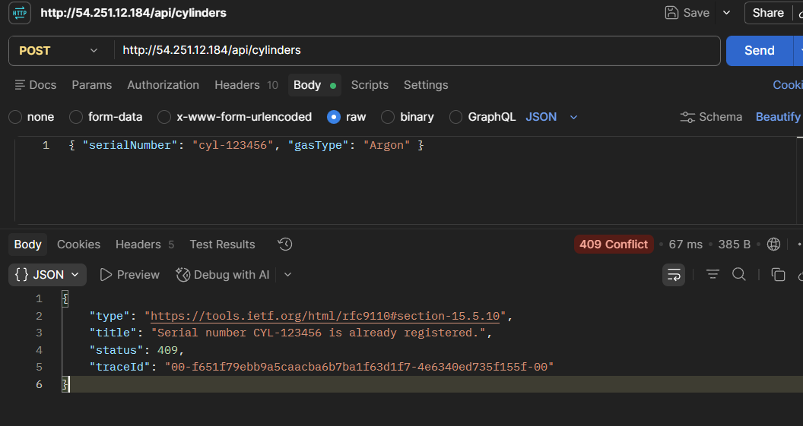
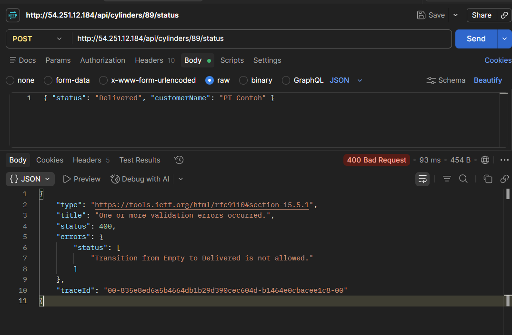
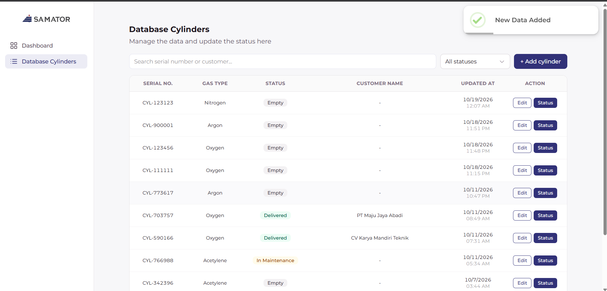
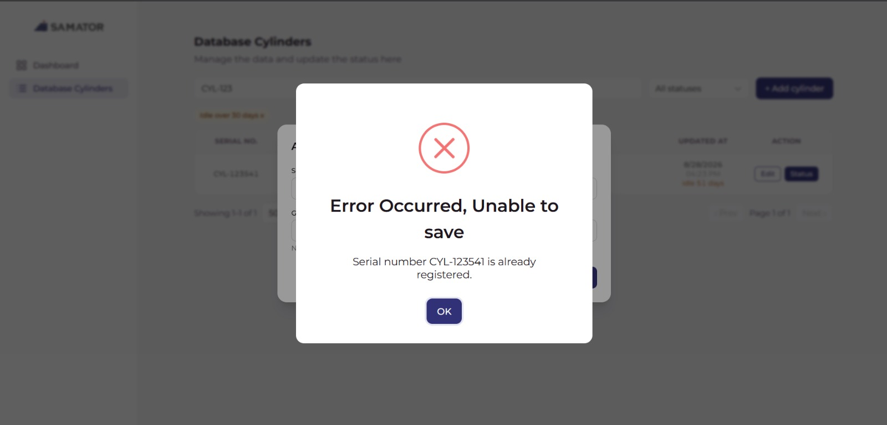
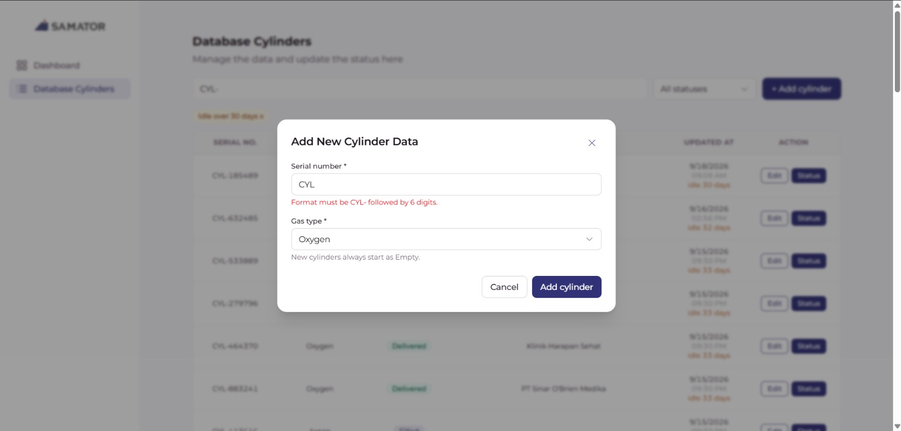

# Samator Cylinder Tracker

Aplikasi web untuk melacak lifecycle tabung gas (pengisian, pengiriman, kembali kosong, inspeksi, hingga retire) sebagai satu *single source of truth* yang menggantikan pencatatan manual di Excel/kertas.

- **Repository:**  [github.com/yustinayunitayy/samator-test](https://github.com/yustinayunitayy/samator-test/)
- **Demo (frontend):**  [samator-test.vercel.app](https://samator-test.vercel.app/)

| Bagian     | Teknologi                                                             |
| ---------- | --------------------------------------------------------------------- |
| Backend    | ASP.NET Core Web API (.NET 8), Entity Framework Core 8, SQLite        |
| Frontend   | React 19, Vite, Tailwind CSS 4, React Router, SweetAlert2, ApexCharts |
| Deployment | Vercel (frontend), Docker di VPS (backend)                            |

**Folder Structure:**
```
backend/
  Controllers/CylindersController.cs   endpoint API
  Data/AppDbContext.cs                 EF Core + field yang dikelola server
  Data/SeedData.cs, cylinders.json     seeding 87 data awal
  Migrations/                          skema database
  Models/                              entity, DTO, dan aturan bisnis (CylinderRules)
frontend/
  src/pages/                           Dashboard dan halaman data tabung
  src/components/                      tabel, form, modal ganti status, pagination
  src/utils/api.js                     pemanggilan API
```

---

## a. Setup dan Cara Menjalankan

**Prasyarat**

- .NET 8 SDK (8.0.426 atau lebih baru di versi 8.0, sesuai `global.json`)
- Node.js 22 LTS (minimal 20.19) dan npm

**1. Backend**

```bash
cd backend
dotnet run
```

- API berjalan di `http://localhost:5226`, dan untuk testing, Swagger dapat dijalankan di `http://localhost:5226/swagger`.
- Saat pertama dijalankan, migrasi diterapkan otomatis, file `cylinders.db` dibuat, dan 87 data dari `Data/cylinders.json` dimasukkan. Tidak perlu menjalankan `dotnet ef` secara manual.
- Untuk mengulang data dari awal: hentikan backend, hapus `backend/cylinders.db`, lalu jalankan lagi.

**2. Frontend** (terminal baru)

```bash
cd frontend
npm install
npm run dev
```

- Buka `http://localhost:5173`. Vite meneruskan semua request `/api` ke `http://localhost:5226`, jadi tidak perlu konfigurasi tambahan.
- Untuk memakai backend di alamat lain, isi `VITE_API_URL` (misalnya di `frontend/.env.local`) dan tambahkan origin frontend ke `AllowedOrigins` di `backend/appsettings.json`.

---

## Ringkasan API
Semua route mengikuti rekomendasi di technical assignment instruction. Ada dua tambahan untuk kebutuhan dashboard (ditandai sebagai *tambahan*).

| Method dan route                                          | Perilaku                                                                                       |
| --------------------------------------------------------- | ----------------------------------------------------------------------------------------------------------------------------------------------------------------------------------------------------------------------------------------------------------------------------------------------------------------------------------------------------------------------------- |
| `GET /api/cylinders?search=&status=&page=1&pageSize=10` | 200`{ items, page, pageSize, totalCount }`. `search` mencocokkan sebagian serial atau nama customer tanpa membedakan huruf besar/kecil;`status` filter persis (tanpa membedakan huruf besar/kecil). Urut `lastUpdated` terbaru lalu `id`. `pageSize` default 10, maksimal 50. Halaman melewati akhir → `items` kosong. `page` < 1, `pageSize` di luar 1–50, atau status tidak dikenal → 400. |
| `GET /api/cylinders?idleOnly=true`                      | *Tambahan:* hanya tabung yang tidak bergerak ≥ 30 hari (tidak termasuk Retired).                                                                                                                                                                                                                                                                                           |
| `GET /api/cylinders/{id}`                               | 200 dengan data tabung, atau 404.                                                                                                                                                                                                                                                                                                                                             |
| `POST /api/cylinders`                                   | Body`serialNumber`, `gasType`. Membuat tabung berstatus `Empty` tanpa customer → 201. Serial duplikat → 409. Validasi gagal → 400.                                                                                                                                                                                                                                   |
| `PUT /api/cylinders/{id}`                               | Body`serialNumber`, `gasType` (status tidak bisa diubah di sini). 404 / 409 / 400.                                                                                                                                                                                                                                                                                        |
| `POST /api/cylinders/{id}/status`                       | Body`status`, dan `customerName` saat pindah ke `Delivered` → 200. Transisi tidak sah atau customer kosong → 400. 404 jika tidak ada.                                                                                                                                                                                                                                 |
| `GET /api/cylinders/summary`                            | *Tambahan:* data summary untuk dashboard: total, jumlah per status dan per jenis gas, jumlah tabung per bulan berdasarkan perubahan terakhir (6 bulan terakhir), dan daftar tabung idle.                                                                  |

Semua error memakai format ProblemDetails (RFC 7807): `title` berisi pesan utama dan `errors` berisi pesan per field. Frontend menampilkan pesan tersebut apa adanya di popup.

**Aturan data berdasarkan technical assignment instruction:**
- **serialNumber:** `CYL-` + 6 digit, unik tanpa membedakan huruf besar/kecil, disimpan dalam huruf kapital.
- **gasType:** Oxygen, Nitrogen, Argon, Carbon Dioxide, Acetylene, Hydrogen.
- **customerName:** wajib saat `Delivered`, maksimal 120 karakter, `null` di status lain.
- **lastUpdated:** timestamp UTC yang diisi server setiap ada perubahan.
- **Transisi status:**

| Dari          | Hanya diperbolehkan transisi ke   |
| ------------- | --------------------------------- |
| Empty         | Filled, InMaintenance, Retired    |
| Filled        | Delivered, InMaintenance, Retired |
| Delivered     | Empty                             |
| InMaintenance | Empty, Retired                    |
| Retired       | (status akhir)                    |

---

## Hasil Testing
Pengujian dilakukan secara manual: backend lewat Swagger/Postman, frontend lewat browser.

### 1. Backend

**a. BE-1 (positif) - Membuat tabung baru** · `POST /api/cylinders`

```json
{ "serialNumber": "CYL-123456", "gasType": "Oxygen" }
```

Hasil: **201 Created**, status otomatis `Empty` dan `customerName` bernilai `null`.



**b. BE-2 (negatif) - Serial duplikat ditolak** · `POST /api/cylinders`

```json
{ "serialNumber": "cyl-123456", "gasType": "Argon" }
```

Hasil: **409 Conflict**, karena serial dianggap sama walaupun ditulis dengan huruf kecil.



**c. BE-3 (negatif) - Transisi status tidak sah** · `POST /api/cylinders/{id}/status` (id dari BE-1)

```json
{ "status": "Delivered", "customerName": "PT Contoh" }
```

Hasil: **400 Bad Request**, karena tabung berstatus `Empty` tidak boleh langsung menjadi `Delivered`.



### 2. Frontend

**a. FE-1 (positif) - Tambah data lewat form**

Klik **+ Add cylinder**, isi serial baru (misalnya `CYL-123123`) dan jenis gas, lalu pilih **Yes, Create** di popup konfirmasi. Muncul notifikasi *New Data Added* dan data baru tampil paling atas di tabel dengan status Empty.



**b. FE-2 (negatif) - Pesan error dari server**

Tambah data lagi dengan serial yang sudah exist (`CYL-123541`). Setelah konfirmasi, muncul popup *Error Occurred, Unable to save* berisi pesan dari server bahwa serial sudah terdaftar.



**c. FE-3 (negatif) - Validasi form untuk serial number tidak valid**

Tambah data lagi dengan serial yang tidak valid (`CYL`), lalu klik **Add cylinder**. Form langsung menampilkan pesan *Format must be CYL- followed by 6 digits.* di bawah kolom serial number, tanpa popup konfirmasi, sehingga data tidak dikirim ke server.



---

## b. Key Design Decisions

1. **Route mengikuti rekomendasi, tanpa perubahan.** Tambahannya hanya `GET /api/cylinders/summary` dan parameter `idleOnly` untuk dashboard, sebagai jawaban atas masalah *Slow Analysis* dan *Idle and Lost Assets* di latar belakang.
2. **Aturan bisnis terpusat di `CylinderRules`.** Format serial, daftar jenis gas, tabel transisi status, dan batas karakter ada di satu tempat, sehingga mudah diubah tanpa menyisir controller.
3. **Duplikasi dicegah di dua lapis.** Controller mengecek serial lebih dulu agar bisa memberi respons 409 yang jelas, dan database memasang *unique index* pada `SerialNumber` sehingga data ganda tetap tidak bisa tersimpan apa pun yang terjadi.
4. **Data kotor dinormalisasi, bukan ditolak.** Serial di-trim dan dijadikan huruf kapital. Jenis gas dan status diterima tanpa membedakan huruf besar/kecil lalu disimpan dalam bentuk baku; nama customer dinormalisasi Unicode, spasi berlebih dirapikan, sedangkan apostrof dan simbol dipertahankan apa adanya. Semua query EF Core terparameterisasi sehingga karakter khusus aman.
5. **Field penting dikelola server.** `lastUpdated` (UTC) dan kolom pencarian diisi otomatis di `SaveChanges`, sehingga tidak bisa dimanipulasi client. Status hanya bisa diubah lewat endpoint status, dan `customerName` otomatis dikosongkan saat tabung keluar dari status `Delivered`.
6. **Pencarian memakai kolom `SearchKey`.** Kolom ini berisi gabungan serial dan nama customer dalam huruf kapital. Fungsi `UPPER/LOWER` bawaan SQLite hanya mengenal huruf ASCII, jadi nilai ini disiapkan di .NET agar pencarian tetap tidak membedakan huruf besar/kecil untuk nama seperti `Östara` atau `Café`.
7. **Pagination stabil.** Urutan `lastUpdated` terbaru lalu `id` memastikan data tidak berpindah
   halaman secara acak saat ada beberapa data dengan waktu yang sama.
8. **Seeding otomatis dan aman diulang.** Migrasi dan seeding berjalan saat aplikasi start, hanya jika database masih kosong. Record yang tidak valid dilewati dan dicatat di log.
9. **Frontend memberi feedback cepat, server tetap penentu.** Form dan modal status memvalidasi input di browser (format serial, nama customer, batas 120 karakter), dan modal status hanya menampilkan status tujuan yang diizinkan. Sebelum data disimpan selalu ada popup konfirmasi. Pesan error dari server tetap ditampilkan apa adanya, dan setiap halaman yang mengambil data punya tampilan loading, kosong, dan error dengan tombol Retry.

---

## c. Asumsi dan Keputusan atas Instruksi yang Kurang Jelas

1. **`id` tidak ada di file JSON.** Instruksi menyebut `id` sudah tersedia di `.json`, tetapi file yang diberikan tidak memiliki field `id`. Saya memperlakukan `id` sebagai *surrogate key* integer yang dibuat otomatis oleh database (autoincrement), diisi berurutan sesuai urutan data di file (1–87). `serialNumber` tetap menjadi *business key* yang unik, tetapi tidak dijadikan primary key karena bisa dikoreksi lewat `PUT`.
2. **`customerName` di luar status Delivered diabaikan.** Jika client mengirim nama customer saat pindah ke status selain `Delivered`, nilainya tidak disimpan (tetap `null`), bukan ditolak.
3. **Pindah ke status yang sama dianggap transisi tidak sah** (misalnya Empty → Empty), karena tidak tercantum di tabel transisi.
4. **Input status dan jenis gas tidak membedakan huruf besar/kecil.** Misalnya `filled` atau `oxygen` diterima dan disimpan sebagai `Filled` dan `Oxygen`.
5. **Filter status yang tidak dikenal mengembalikan 400**, dan `pageSize` di bawah 1 juga 400, mengikuti pola validasi untuk `page` dan `pageSize` di instruksi.
6. **`lastUpdated` data awal dipertahankan** dari file JSON karena merupakan data historis; setelah itu server mengisinya setiap ada perubahan.
7. **Data awal berstatus Delivered tanpa nama customer tetap diimpor** dengan peringatan di log agar tidak ada tabung yang hilang dari catatan (file yang diberikan tidak memiliki kasus ini).
8. **Tabung dianggap idle** jika tidak ada perubahan selama 30 hari atau lebih, tidak termasuk yang sudah Retired.
9. **Grafik 6 bulan terakhir dihitung dari `lastUpdated`.** Karena sistem hanya menyimpan kondisi terakhir setiap tabung (belum ada tabel riwayat), grafik ini menunjukkan kapan tabung terakhir kali berubah, bukan seluruh pergerakannya. Riwayat lengkap direncanakan di bagian d.

---

## d. Jika Ada Waktu Lebih

1. **Request bersamaan dengan serial yang sama (*race condition*).** Database sudah menjamin tidak ada duplikat yang tersimpan, tetapi request kedua saat ini mendapat respons 500. Rencananya error *unique constraint* ditangkap lalu dikembalikan sebagai 409.
2. **Riwayat lifecycle per tabung** (siapa mengubah apa dan kapan), agar alur pengisian, pengiriman, dan inspeksi bisa diaudit sepenuhnya.
3. **Login dan pembagian peran** (misalnya operator dan admin), karena saat ini semua pengguna bisa mengubah data.
4. **Pelacakan lokasi dan data master customer**, untuk menjawab masalah tabung yang lokasinya tidak terdeteksi.
5. **Import/export Excel** untuk memudahkan tim operasional berpindah dari pencatatan manual.
6. **Scan barcode/QR serial number** untuk mengurangi salah tulis di lapangan.

---

## e. Penggunaan AI

Ya, saya menggunakan AI dalam pengerjaan project ini:

- **Backend:** ini pertama kalinya saya membangun project dengan .NET dan C#. Saya sudah mengenal teknologi tersebut namun baru belajar konsep dasar C# dan .NET, dan belum pernah menggunakannya secara langsung (*hands-on*) dalam sebuah project. AI saya manfaatkan sebagai pendamping belajar untuk menjelaskan konsep ASP.NET Core Web API dan Entity Framework Core, serta membuatkan kerangka contoh pembuatan API yang kemudian saya pelajari, sesuaikan, dan kembangkan sesuai instruksi.
- **Frontend:** AI membantu pengerjaan halaman dashboard karena keterbatasan waktu. Bagian frontend lainnya saya kerjakan sendiri.
- **Review, pengujian, dan dokumentasi:** AI juga membantu mengecek kesesuaian backend dengan requirement, menyusun skenario pengujian, menyiapkan deployment, dan merapikan README ini.

---

## Deployment

- **Frontend:** Vercel.
- **Backend:** container Docker (runtime ASP.NET Core 8) dengan Docker Compose di sebuah VPS. Database SQLite disimpan di volume Docker agar tidak hilang saat container dibuat ulang.
- **Alur request:** browser hanya berkomunikasi dengan Vercel. Vercel meneruskan request `/api/*` ke backend sambil menambahkan header rahasia, dan gateway nginx di depan backend menolak request yang tidak membawa header tersebut. Dengan begitu backend tidak bisa dipanggil langsung dari internet.
